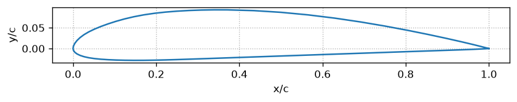
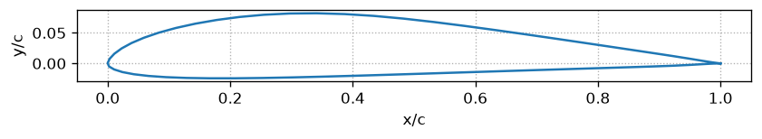

# Подбор профиля

V крейсерская = 14 м/с, V сваливания = 9 м/с, масса = 5 кг, удлинение = 9, шарнир закрылка x/c = 0.75

## CLARK-Y

Толщина 0.1172 (x/c = 0.308), кривизна 0.0353 (x/c = 0.434)

| Угол закрылка, ° | Cy_max | Re |
|---|---|---|
| 0 | 1.3352 | 1.7207e+05 |
| 5 | 1.4227 | 1.6669e+05 |
| 10 | 1.5024 | 1.6222e+05 |
| 15 | 1.5718 | 1.5859e+05 |
| 20 | 1.629 | 1.5579e+05 |
| 25 | 1.6732 | 1.5372e+05 |
| 30 | 1.7015 | 1.5243e+05 |
| 35 | 1.7194 | 1.5174e+05 |

**Лучший угол закрылка: 35°, Cy_max = 1.719. Cx на крейсере = 0.030821**

## E205

Толщина 0.1048 (x/c = 0.297), кривизна 0.0297 (x/c = 0.341)

| Угол закрылка, ° | Cy_max | Re |
|---|---|---|
| 0 | 1.1642 | 1.8427e+05 |
| 5 | 1.273 | 1.7622e+05 |
| 10 | 1.3718 | 1.6982e+05 |
| 15 | 1.4583 | 1.6465e+05 |
| 20 | 1.5258 | 1.6096e+05 |
| 25 | 1.5892 | 1.5772e+05 |
| 30 | 1.6393 | 1.553e+05 |
| 35 | 1.6789 | 1.5345e+05 |

