# Подбор профиля

V крейсерская = 14 м/с, V сваливания = 9 м/с, масса = 5 кг, удлинение = 9, шарнир закрылка x/c = 0.75

## CLARK-Y

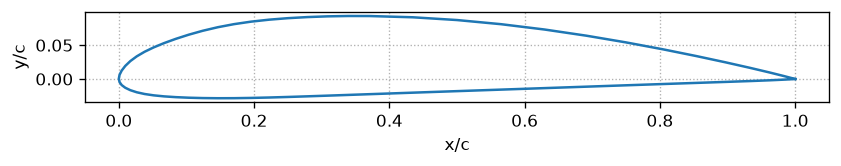

Толщина 0.1172 (x/c = 0.308), кривизна 0.0353 (x/c = 0.434)

| Угол закрылка, ° | Cy_max | Re |
|---|---|---|
| 0 | 1.3352 | 1.7207e+05 |
| 5 | 1.4227 | 1.6669e+05 |
| 10 | 1.5024 | 1.6222e+05 |
| 15 | 1.5718 | 1.5859e+05 |
| 20 | 1.629 | 1.5579e+05 |
| 25 | 1.6732 | 1.5372e+05 |
| 30 | 1.7015 | 1.5243e+05 |
| 35 | 1.7194 | 1.5174e+05 |

**Лучший угол закрылка: 35°, Cy_max = 1.719. Cx на крейсере = 0.030821**

## E205

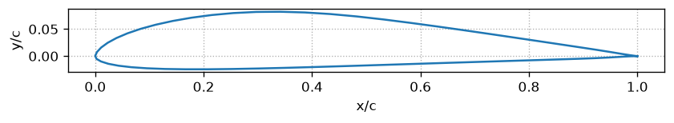

Толщина 0.1048 (x/c = 0.297), кривизна 0.0297 (x/c = 0.341)

| Угол закрылка, ° | Cy_max | Re |
|---|---|---|
| 0 | 1.1642 | 1.8427e+05 |
| 5 | 1.273 | 1.7622e+05 |
| 10 | 1.3718 | 1.6982e+05 |
| 15 | 1.4583 | 1.6465e+05 |
| 20 | 1.5258 | 1.6096e+05 |
| 25 | 1.5892 | 1.5772e+05 |
| 30 | 1.6393 | 1.553e+05 |
| 35 | 1.6789 | 1.5345e+05 |

Ошибка расчёта: Command '['C:\\Users\\hp\\OneDrive\\Рабочий стол\\Morphing_Wing_Instrument\\dafeaero\\xfoilpy\\xfoil_software\\xfoil.exe']' timed out after 60 seconds. Профиль пропущен.

## E374

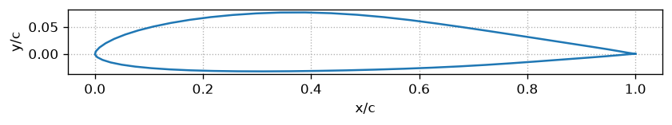

Толщина 0.1091 (x/c = 0.344), кривизна 0.0232 (x/c = 0.389)

| Угол закрылка, ° | Cy_max | Re |
|---|---|---|
| 0 | 1.0642 | 1.9274e+05 |
| 5 | 1.1771 | 1.8325e+05 |
| 10 | 1.2822 | 1.7558e+05 |
| 20 | 1.4265 | 1.6572e+05 |
| 25 | 1.5077 | 1.6193e+05 |
| 35 | 1.5991 | 1.5725e+05 |

**Лучший угол закрылка: 35°, Cy_max = 1.599. Cx на крейсере = 0.028591**

## E423

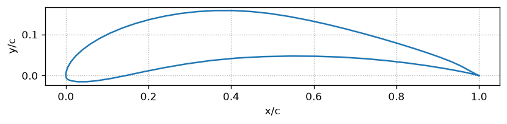

Толщина 0.1252 (x/c = 0.240), кривизна 0.0998 (x/c = 0.448)

| Угол закрылка, ° | Cy_max | Re |
|---|---|---|
| 0 | 1.8806 | 1.4484e+05 |
| 5 | 1.5849 | 1.4171e+05 |
| 10 | 1.5559 | 1.4067e+05 |
| 15 | 0.7285 | 1.3673e+05 |
| 20 | 1.5177 | 1.614e+05 |
| 25 | 2.2075 | 4.6504e+05 |
| 30 | 2.1965 | 4.6352e+05 |

**Лучший угол закрылка: 25°, Cy_max = 2.208. Cx на крейсере = 0.053864**

## FX63-137

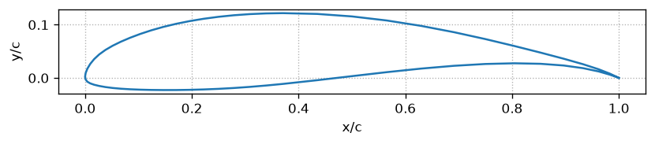

Толщина 0.1368 (x/c = 0.308), кривизна 0.0584 (x/c = 0.565)

| Угол закрылка, ° | Cy_max | Re |
|---|---|---|
| 0 | 1.811 | 1.4776e+05 |
| 5 | 1.8815 | 1.4495e+05 |
| 10 | 1.9525 | 1.4226e+05 |
| 15 | 2.0065 | 1.4038e+05 |
| 20 | 2.0307 | 1.3952e+05 |
| 25 | 2.0349 | 1.3938e+05 |
| 30 | 2.0353 | 1.3934e+05 |
| 35 | 2.0172 | 1.3998e+05 |

**Лучший угол закрылка: 30°, Cy_max = 2.035. Cx на крейсере = 0.042999**

## FX63_100

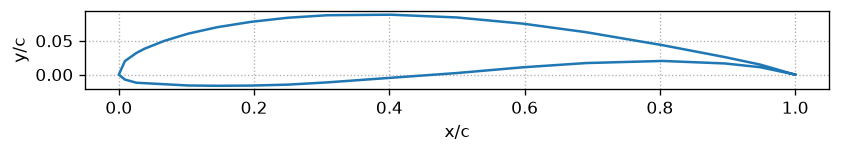

Толщина 0.0993 (x/c = 0.308), кривизна 0.0434 (x/c = 0.500)

| Угол закрылка, ° | Cy_max | Re |
|---|---|---|
| 0 | 1.5665 | 1.5883e+05 |
| 5 | 1.6599 | 1.5434e+05 |
| 10 | 1.7337 | 1.51e+05 |
| 25 | 1.8712 | 1.4536e+05 |
| 30 | 1.8838 | 1.4486e+05 |
| 35 | 1.8935 | 1.4448e+05 |

**Лучший угол закрылка: 35°, Cy_max = 1.893. Cx на крейсере = 0.036026**

## FX63_137

Толщина 0.1368 (x/c = 0.308), кривизна 0.0584 (x/c = 0.565)

| Угол закрылка, ° | Cy_max | Re |
|---|---|---|
| 0 | 1.811 | 1.4776e+05 |
| 5 | 1.8815 | 1.4495e+05 |
| 10 | 1.9525 | 1.4226e+05 |
| 15 | 2.0065 | 1.4038e+05 |
| 20 | 2.0307 | 1.3952e+05 |
| 25 | 2.0349 | 1.3938e+05 |
| 30 | 2.0353 | 1.3934e+05 |
| 35 | 2.0172 | 1.3998e+05 |

**Лучший угол закрылка: 30°, Cy_max = 2.035. Cx на крейсере = 0.042999**

## goe346

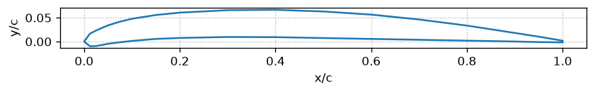

Толщина 0.0574 (x/c = 0.399), кривизна 0.0379 (x/c = 0.399)

| Угол закрылка, ° | Cy_max | Re |
|---|---|---|
| 0 | 1.3139 | 1.7343e+05 |
| 5 | 1.4402 | 1.6574e+05 |
| 15 | 1.6129 | 1.5657e+05 |
| 20 | 1.6615 | 1.5426e+05 |
| 25 | 1.6851 | 1.5314e+05 |
| 30 | 1.7183 | 1.5168e+05 |
| 35 | 1.7387 | 1.5071e+05 |

**Лучший угол закрылка: 35°, Cy_max = 1.739. Cx на крейсере = 0.032278**

## MH32

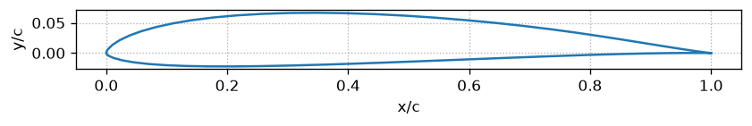

Толщина 0.0870 (x/c = 0.301), кривизна 0.0239 (x/c = 0.444)

| Угол закрылка, ° | Cy_max | Re |
|---|---|---|
| 0 | 1.1134 | 1.8847e+05 |
| 10 | 1.3495 | 1.7114e+05 |
| 15 | 1.4462 | 1.6532e+05 |
| 20 | 1.5212 | 1.6121e+05 |
| 25 | 1.5698 | 1.5869e+05 |
| 30 | 1.5597 | 1.5659e+05 |
| 35 | 1.6328 | 1.5556e+05 |

**Лучший угол закрылка: 35°, Cy_max = 1.633. Cx на крейсере = 0.027941**

## NACA6409

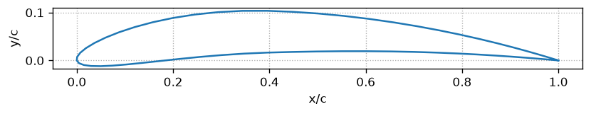

Толщина 0.0903 (x/c = 0.293), кривизна 0.0600 (x/c = 0.396)

| Угол закрылка, ° | Cy_max | Re |
|---|---|---|
| 0 | 1.4666 | 1.6443e+05 |
| 5 | 1.5199 | 1.6129e+05 |
| 10 | 1.6392 | 1.5534e+05 |
| 15 | 1.698 | 1.526e+05 |
| 20 | 1.7465 | 1.5045e+05 |
| 30 | 1.8313 | 1.469e+05 |
| 35 | 1.8714 | 1.4535e+05 |

**Лучший угол закрылка: 35°, Cy_max = 1.871. Cx на крейсере = 0.034847**

## RG15A11

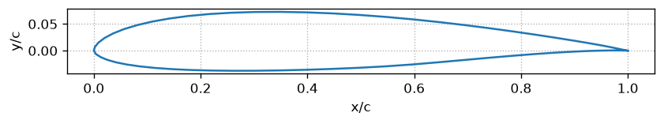

Толщина 0.1100 (x/c = 0.303), кривизна 0.0180 (x/c = 0.397)

| Угол закрылка, ° | Cy_max | Re |
|---|---|---|
| 0 | 1.2055 | 1.8114e+05 |
| 10 | 1.4148 | 1.6713e+05 |
| 15 | 1.4943 | 1.6266e+05 |
| 20 | 1.5603 | 1.5916e+05 |
| 25 | 1.6112 | 1.5663e+05 |
| 35 | 1.6771 | 1.5356e+05 |

**Лучший угол закрылка: 35°, Cy_max = 1.677. Cx на крейсере = 0.029975**

## S1210

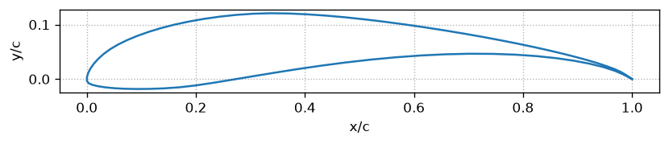

Толщина 0.1201 (x/c = 0.214), кривизна 0.0707 (x/c = 0.511)

| Угол закрылка, ° | Cy_max | Re |
|---|---|---|
| 0 | 1.9777 | 1.4139e+05 |
| 5 | 2.0443 | 1.391e+05 |
| 10 | 2.1044 | 1.3707e+05 |
| 15 | 2.1189 | 1.3656e+05 |
| 20 | 2.1393 | 1.3597e+05 |
| 25 | 2.1526 | 1.3552e+05 |
| 30 | 2.1339 | 1.361e+05 |
| 35 | 2.0954 | 1.3736e+05 |

**Лучший угол закрылка: 25°, Cy_max = 2.153. Cx на крейсере = 0.047037**

## s1223

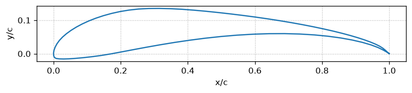

Толщина 0.1214 (x/c = 0.198), кривизна 0.0858 (x/c = 0.491)

| Угол закрылка, ° | Cy_max | Re |
|---|---|---|
| 0 | 2.2066 | 1.3384e+05 |
| 5 | 2.301 | 1.31e+05 |
| 10 | 2.3426 | 1.299e+05 |
| 15 | 2.3603 | 1.2939e+05 |
| 20 | 2.3288 | 1.3029e+05 |
| 25 | 2.3091 | 1.3065e+05 |
| 30 | 2.2404 | 1.3293e+05 |

**Лучший угол закрылка: 15°, Cy_max = 2.360. Cx на крейсере = 0.059373**

## S4083

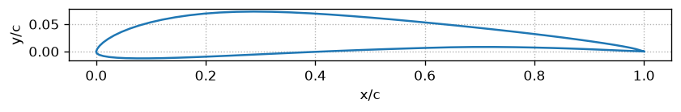

Толщина 0.0800 (x/c = 0.226), кривизна 0.0344 (x/c = 0.356)

| Угол закрылка, ° | Cy_max | Re |
|---|---|---|
| 0 | 1.2884 | 1.7515e+05 |
| 5 | 1.3952 | 1.6833e+05 |
| 10 | 1.486 | 1.6311e+05 |
| 15 | 1.5578 | 1.5932e+05 |
| 20 | 1.6133 | 1.5654e+05 |
| 25 | 1.6712 | 1.5381e+05 |
| 30 | 1.7131 | 1.5191e+05 |

**Лучший угол закрылка: 30°, Cy_max = 1.713. Cx на крейсере = 0.031348**

## S5010

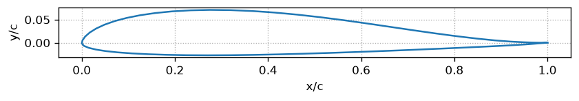

Толщина 0.0983 (x/c = 0.276), кривизна 0.0230 (x/c = 0.276)

| Угол закрылка, ° | Cy_max | Re |
|---|---|---|
| 0 | 1.2023 | 1.8132e+05 |
| 5 | 1.3192 | 1.731e+05 |
| 10 | 1.4237 | 1.6664e+05 |
| 15 | 1.5141 | 1.6157e+05 |
| 20 | 1.5862 | 1.5788e+05 |
| 25 | 1.6447 | 1.5504e+05 |
| 30 | 1.6928 | 1.5282e+05 |
| 35 | 1.7273 | 1.513e+05 |

**Лучший угол закрылка: 35°, Cy_max = 1.727. Cx на крейсере = 0.032343**

## S7055

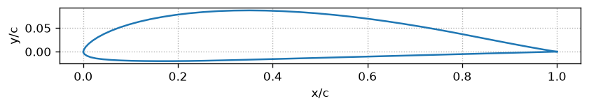

Толщина 0.1050 (x/c = 0.317), кривизна 0.0360 (x/c = 0.386)

| Угол закрылка, ° | Cy_max | Re |
|---|---|---|
| 0 | 1.2452 | 1.7821e+05 |
| 10 | 1.4308 | 1.6623e+05 |
| 20 | 1.566 | 1.589e+05 |
| 25 | 1.6146 | 1.5666e+05 |
| 30 | 1.6539 | 1.5461e+05 |
| 35 | 1.6869 | 1.5309e+05 |

**Лучший угол закрылка: 35°, Cy_max = 1.687. Cx на крейсере = 0.030020**

## S8052

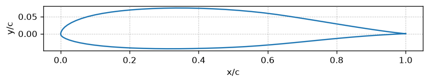

Толщина 0.1189 (x/c = 0.334), кривизна 0.0160 (x/c = 0.369)

| Угол закрылка, ° | Cy_max | Re |
|---|---|---|
| 0 | 1.2406 | 1.7855e+05 |
| 5 | 1.3601 | 1.7049e+05 |
| 10 | 1.4641 | 1.6427e+05 |
| 15 | 1.5496 | 1.5972e+05 |
| 20 | 1.6164 | 1.5639e+05 |
| 25 | 1.6747 | 1.5364e+05 |
| 30 | 1.7188 | 1.5166e+05 |
| 35 | 1.7535 | 1.5015e+05 |

**Лучший угол закрылка: 35°, Cy_max = 1.754. Cx на крейсере = 0.032389**

## SC(2)-0714

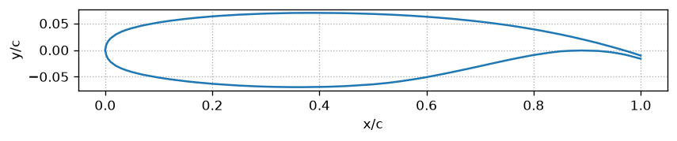

Толщина 0.1393 (x/c = 0.371), кривизна 0.0254 (x/c = 0.800)

| Угол закрылка, ° | Cy_max | Re |
|---|---|---|
| 0 | 1.2635 | 1.7686e+05 |
| 5 | 1.3618 | 1.7039e+05 |
| 10 | 1.3038 | 1.6423e+05 |
| 15 | 1.4965 | 1.6252e+05 |
| 25 | 1.5131 | 1.6142e+05 |
| 30 | 1.5599 | 1.592e+05 |
| 35 | 1.5433 | 1.5998e+05 |

**Лучший угол закрылка: 30°, Cy_max = 1.560. Cx на крейсере = 0.033259**

## SD6080

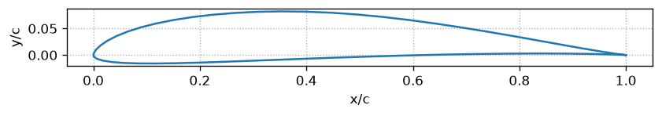

Толщина 0.0919 (x/c = 0.308), кривизна 0.0359 (x/c = 0.446)

| Угол закрылка, ° | Cy_max | Re |
|---|---|---|
| 0 | 1.3179 | 1.7318e+05 |
| 5 | 1.4267 | 1.6646e+05 |
| 10 | 1.5218 | 1.6114e+05 |
| 15 | 1.6004 | 1.5717e+05 |
| 20 | 1.6696 | 1.539e+05 |
| 25 | 1.7221 | 1.5151e+05 |
| 30 | 1.7728 | 1.4932e+05 |
| 35 | 1.8084 | 1.4784e+05 |

**Лучший угол закрылка: 35°, Cy_max = 1.808. Cx на крейсере = 0.033394**

## SD7003

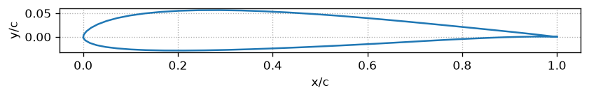

Толщина 0.0851 (x/c = 0.244), кривизна 0.0158 (x/c = 0.334)

| Угол закрылка, ° | Cy_max | Re |
|---|---|---|
| 0 | 1.2026 | 1.8132e+05 |
| 5 | 1.3377 | 1.7192e+05 |
| 10 | 1.4507 | 1.6506e+05 |
| 15 | 1.5476 | 1.5978e+05 |
| 20 | 1.6222 | 1.5612e+05 |
| 25 | 1.6769 | 1.5357e+05 |
| 30 | 1.7189 | 1.5164e+05 |
| 35 | 1.7429 | 1.5061e+05 |

**Лучший угол закрылка: 35°, Cy_max = 1.743. Cx на крейсере = 0.033317**

## SD7032

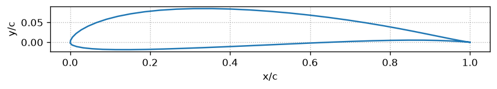

Толщина 0.0996 (x/c = 0.266), кривизна 0.0379 (x/c = 0.402)

| Угол закрылка, ° | Cy_max | Re |
|---|---|---|
| 0 | 1.4187 | 1.6694e+05 |
| 5 | 1.5189 | 1.6133e+05 |
| 10 | 1.6025 | 1.5706e+05 |
| 15 | 1.6712 | 1.5378e+05 |
| 20 | 1.7253 | 1.5137e+05 |
| 25 | 1.765 | 1.4966e+05 |
| 30 | 1.7875 | 1.4869e+05 |
| 35 | 1.8104 | 1.478e+05 |

**Лучший угол закрылка: 35°, Cy_max = 1.810. Cx на крейсере = 0.032970**

## sd7034

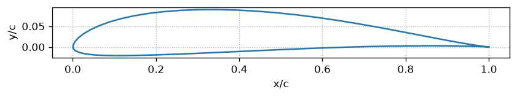

Толщина 0.1051 (x/c = 0.261), кривизна 0.0409 (x/c = 0.394)

| Угол закрылка, ° | Cy_max | Re |
|---|---|---|
| 0 | 1.4154 | 1.6712e+05 |
| 5 | 1.5145 | 1.6157e+05 |
| 10 | 1.5997 | 1.5721e+05 |
| 15 | 1.6731 | 1.5372e+05 |
| 20 | 1.7367 | 1.5088e+05 |
| 25 | 1.787 | 1.4874e+05 |
| 35 | 1.8528 | 1.4607e+05 |

**Лучший угол закрылка: 35°, Cy_max = 1.853. Cx на крейсере = 0.034858**

## SD7037

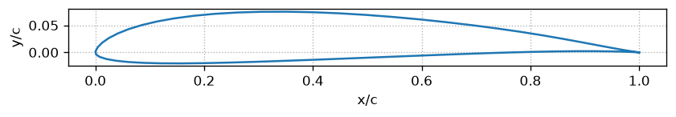

Толщина 0.0920 (x/c = 0.290), кривизна 0.0291 (x/c = 0.447)

| Угол закрылка, ° | Cy_max | Re |
|---|---|---|
| 0 | 1.3057 | 1.7401e+05 |
| 5 | 1.4119 | 1.6733e+05 |
| 10 | 1.5051 | 1.6207e+05 |
| 15 | 1.5844 | 1.5796e+05 |
| 20 | 1.6497 | 1.5479e+05 |
| 25 | 1.6993 | 1.5248e+05 |
| 30 | 1.7398 | 1.5074e+05 |
| 35 | 1.7748 | 1.4925e+05 |

**Лучший угол закрылка: 35°, Cy_max = 1.775. Cx на крейсере = 0.031989**

## SD8020

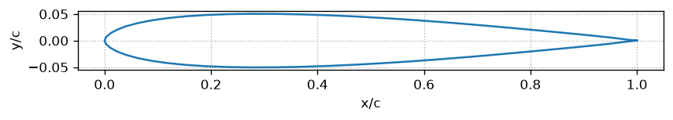

Толщина 0.1010 (x/c = 0.275), кривизна 0.0000 (x/c = 0.421)

| Угол закрылка, ° | Cy_max | Re |
|---|---|---|
| 0 | 0.9366 | 2.0546e+05 |
| 10 | 1.1846 | 1.827e+05 |
| 15 | 1.2888 | 1.751e+05 |
| 20 | 1.3707 | 1.6982e+05 |
| 25 | 1.4369 | 1.6583e+05 |
| 30 | 1.4946 | 1.6264e+05 |
| 35 | 1.5348 | 1.6048e+05 |

**Лучший угол закрылка: 35°, Cy_max = 1.535. Cx на крейсере = 0.029172**

## SG6041

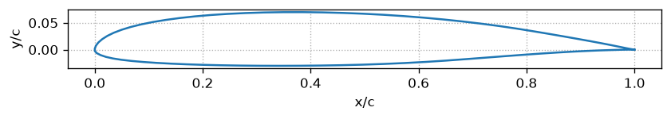

Толщина 0.1000 (x/c = 0.349), кривизна 0.0188 (x/c = 0.422)

| Угол закрылка, ° | Cy_max | Re |
|---|---|---|
| 0 | 1.23 | 1.7924e+05 |
| 5 | 1.3466 | 1.7133e+05 |
| 10 | 1.45 | 1.6511e+05 |
| 15 | 1.5334 | 1.6055e+05 |
| 20 | 1.5974 | 1.5732e+05 |
| 25 | 1.6474 | 1.5491e+05 |
| 35 | 1.7192 | 1.5163e+05 |

**Лучший угол закрылка: 35°, Cy_max = 1.719. Cx на крейсере = 0.030319**

## Итоги

Лучший профиль: **MH32** (Cx = 0.027941, закрылок 35°)

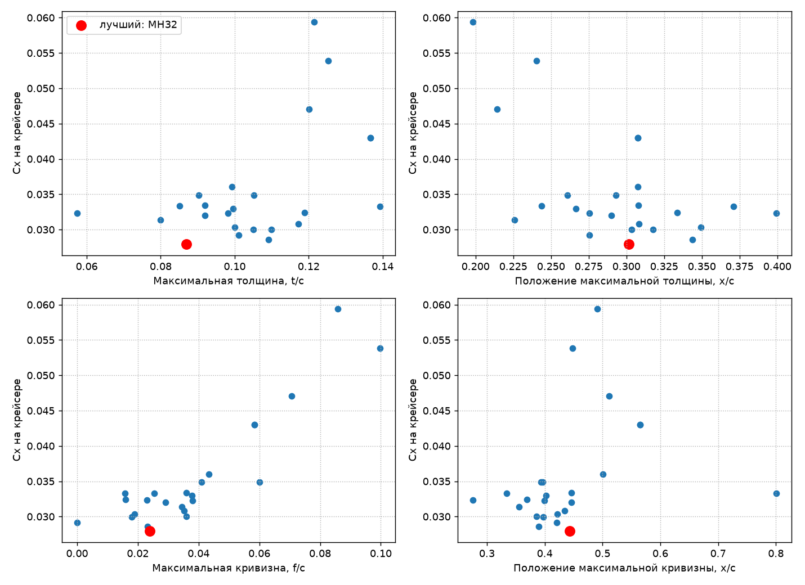

У симметричных профилей кривизна и её положение равны нулю, поэтому их точки лежат на оси.

| Airfoil | thickness | thickness_pos | camber | camber_pos | Flap_Angle | Cy_max | Cx_total |
|---|---|---|---|---|---|---|---|
| MH32 | 0.086975 | 0.30142 | 0.023887 | 0.44356 | 35 | 1.6328 | 0.027941 |
| E374 | 0.1091 | 0.34357 | 0.023203 | 0.38933 | 35 | 1.5991 | 0.028591 |
| SD8020 | 0.10102 | 0.27545 | 4.8183e-06 | 0.42094 | 35 | 1.5348 | 0.029172 |
| RG15A11 | 0.10996 | 0.30343 | 0.017965 | 0.39721 | 35 | 1.6771 | 0.029975 |
| S7055 | 0.10501 | 0.31745 | 0.036036 | 0.38616 | 35 | 1.6869 | 0.03002 |
| SG6041 | 0.099951 | 0.34942 | 0.018839 | 0.42192 | 35 | 1.7192 | 0.030319 |
| CLARK-Y | 0.11724 | 0.30834 | 0.035282 | 0.43425 | 35 | 1.7194 | 0.030821 |
| S4083 | 0.079997 | 0.22577 | 0.034431 | 0.35581 | 30 | 1.7131 | 0.031348 |
| SD7037 | 0.092013 | 0.29 | 0.029105 | 0.44655 | 35 | 1.7748 | 0.031989 |
| goe346 | 0.057398 | 0.39925 | 0.037942 | 0.39908 | 35 | 1.7387 | 0.032278 |
| S5010 | 0.098263 | 0.27566 | 0.023021 | 0.27588 | 35 | 1.7273 | 0.032343 |
| S8052 | 0.11891 | 0.33367 | 0.015983 | 0.36883 | 35 | 1.7535 | 0.032389 |
| SD7032 | 0.09959 | 0.26635 | 0.037914 | 0.40237 | 35 | 1.8104 | 0.03297 |
| SC(2)-0714 | 0.13934 | 0.37093 | 0.025422 | 0.80046 | 30 | 1.5599 | 0.033259 |
| SD7003 | 0.085076 | 0.24365 | 0.015816 | 0.334 | 35 | 1.7429 | 0.033317 |
| SD6080 | 0.091922 | 0.30789 | 0.035891 | 0.44577 | 35 | 1.8084 | 0.033394 |
| NACA6409 | 0.090325 | 0.29297 | 0.059989 | 0.39638 | 35 | 1.8714 | 0.034847 |
| sd7034 | 0.10514 | 0.26076 | 0.040915 | 0.39386 | 35 | 1.8528 | 0.034858 |
| FX63_100 | 0.099303 | 0.30765 | 0.043426 | 0.50025 | 35 | 1.8935 | 0.036026 |
| FX63-137 | 0.13676 | 0.30768 | 0.058394 | 0.56466 | 30 | 2.0353 | 0.042999 |
| FX63_137 | 0.13676 | 0.30768 | 0.058394 | 0.56466 | 30 | 2.0353 | 0.042999 |
| S1210 | 0.12007 | 0.21444 | 0.070675 | 0.51126 | 25 | 2.1526 | 0.047037 |
| E423 | 0.12522 | 0.24029 | 0.099809 | 0.44791 | 25 | 2.2075 | 0.053864 |
| s1223 | 0.12144 | 0.19833 | 0.085797 | 0.49052 | 15 | 2.3603 | 0.059373 |

